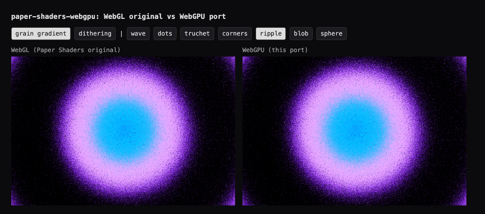

# paper-shaders-webgpu

Unofficial WebGPU (WGSL) port of two [Paper Shaders](https://github.com/paper-design/shaders) effects, **grain gradient** and **dithering**, as React components. Same props as the originals, a lot less GPU work.

Not affiliated with or endorsed by Paper. Apache-2.0, see [NOTICE](NOTICE).



## Usage

```tsx
import { WebGPUGrainGradient, WebGPUDithering } from 'paper-shaders-webgpu';

<WebGPUGrainGradient
  width="100%"
  height="100%"
  colors={['#7300ff', '#eba8ff', '#00bfff', '#2a00ff']}
  colorBack="#000"
  shape="ripple"
  onRenderFailed={() => setFallback(true)}
/>
```

Props, names and defaults follow `@paper-design/shaders-react` (`shape`, `colors`, `softness`, `intensity`, `noise`, `fit`, `scale`, `rotation`, `offsetX/Y`, `originX/Y`, `worldWidth/Height`, `speed`, `frame`, `type`, `size`, `maxPixelCount`).

There is **no WebGL fallback**. If WebGPU is missing or setup fails, nothing is drawn and `onRenderFailed` fires, so render your own fallback (a flat colour is fine).

Differences from the originals: `maxPixelCount` defaults to 1.5M pixels, not about 20M; there is no `pxSize` alias and no `minPixelRatio`. The effect re-creates its pipeline when the `colors` array identity changes, so keep that array stable.

## Performance

Chrome 155, macOS, Apple GPU (Metal 3), 120 Hz display, devicePixelRatio 2. N identical shaders are stacked on one 960×640 CSS-pixel stage (about 614k pixels each), so GPU load scales with N. Each run is 6 s after a 2 s warm-up, in a fresh iframe, one engine at a time, so the two never share the GPU. Two rounds, engine order alternated. Frames come from `requestAnimationFrame` deltas. Both engines render the same pixel count.

**Grain gradient (`ripple`)**

| Stacked copies | WebGL (Paper) | WebGPU (this port) |
| --- | --- | --- |
| 1 | 120 fps | 120 fps |
| 4 | 120 fps | 120 fps |
| 8 | 84 / 79 fps, p95 frame 24 ms | **120 / 120 fps**, p95 9 ms |
| 16 | 41 / 41 fps, median frame 24.5 ms | **68 / 66 fps**, median frame 15–16 ms |

Two figures per cell are the two rounds. At 16 copies WebGPU runs about 60% more frames than WebGL. At 8 copies it holds the display's full rate while WebGL drops a third.

**Dithering (`simplex`)** stays at 120 fps for both engines up to 8 copies, so it is too light to separate them on this GPU.

Watching GPU load in the system monitor during the 16-copy grain run, WebGPU sat around 60–65% while WebGL pinned at 90–100% (read by eye, not logged).

This is one powerful machine. A 120 Hz cap hides headroom, which is why the test stacks copies to find where each engine falls over. Lower-end or integrated GPUs will hit that point at much lower counts, and the relative gap is the number to take from this. The `heavy` set in `demo/bench-all.html` (truchet, wave, 16 dither copies) was written but not run.

Run it yourself: `pnpm dev`, then open `/bench-all.html?rounds=2&secs=6` and read `window.__all`. A single run is `/bench.html?engine=webgpu&kind=grain&shape=ripple&n=8`.

## Accuracy

`/diff.html` renders both engines at a frozen frame and pixel-diffs them (480×320 CSS px at 2x).

- **Dithering: bit-identical** (0 difference on every pixel) for all 7 shapes × 4 dither types.
- **Grain gradient: bit-identical** for wave, dots, truchet, corners, ripple and sphere.
- **Grain gradient `blob`** differs (mean block difference about 8/255). Known, not yet fixed.

The port ships Paper's own 128×128 noise texture. A home-made one is what made random-driven shapes (truchet, wave) pick different cells.

`pnpm test` fuzzes the sizing math against the GLSL original.

## Compare it yourself

```bash
pnpm install
pnpm dev        # side-by-side at /index.html, plus /diff.html and /bench.html
pnpm build      # library into dist/
```

Needs a browser with WebGPU (Chrome/Edge 113+, Safari 26+, Firefox recent). Not every shader in Paper is ported, only the two above.

## License

Apache-2.0. The shader logic and noise texture derive from [paper-design/shaders](https://github.com/paper-design/shaders).
